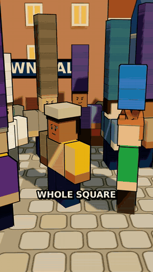
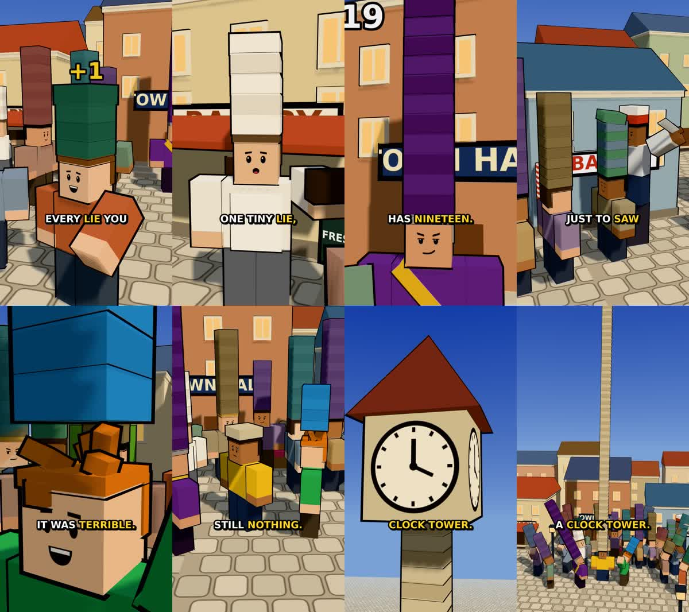

# Roblox Reels

Claude skills that make vertical story reels in code: Roblox-style "In this town, ..." shorts, cartoon 3D shorts, word-synced captions and Minecraft shorts. The picture is rendered with three.js inside [Remotion](https://www.remotion.dev/) on your own machine. No Roblox Studio and no AI video generator are needed for the main skill.

[](LICENSE) [](https://playlikemen.github.io/roblox-reels-skill/) [](https://github.com/playlikemen/roblox-reels-skill/releases/latest)

<p align="center">
  
</p>
<p align="center"><i>"Hat Town", 42 s, made with the <code>roblox-reels</code> skill. <a href="https://playlikemen.github.io/roblox-reels-skill/">Watch it on the project page</a> or <a href="https://playlikemen.github.io/roblox-reels-skill/sample/hat-town.mp4">download the sample MP4</a>.</i></p>

## Skills

| Skill | What it does |
|---|---|
| [`roblox-reels`](skills/roblox-reels) | **Start here.** A 30-60 s narrated "In this town" reel with original blocky characters: script, local AI voice, word-synced shot plan, toon 3D world, stickers, music and sound effects, captions, QA and a reels page. Ships a full worked example and the audio assets. |
| [`roblox-in-this-town`](skills/roblox-in-this-town) | Know-how for Roblox story shorts made in Roblox Studio over MCP: what goes viral, story, camera, faces, pitfalls. |
| [`cartoon-3d-short`](skills/cartoon-3d-short) | 55-70 s cartoon story shorts: 2D characters in a 3D world, with script formulas, acting presets, sound mix and QA agents. |
| [`claude-animated-shorts`](skills/claude-animated-shorts) | The original bridge-short version of the cartoon 3D skill, with its full source template and measured look reports. |
| [`captions`](skills/captions) | Word-synced captions as a separate green-screen or alpha clip, kept clear of the Shorts UI. |
| [`minecraft-shorts`](skills/minecraft-shorts) | Minecraft short scripts with an in-game test list and a shot list. |
| [`minecraft-story`](skills/minecraft-story) | 2:15 "In this world" Minecraft story videos, built code-first with sub-agents. |

## Install

### Claude Code: plugin (recommended)

Run these inside Claude Code:

```
/plugin marketplace add playlikemen/roblox-reels-skill
/plugin install roblox-reels@roblox-reels
```

Skills then appear as `roblox-reels:roblox-reels`, `roblox-reels:captions` and so on.

To update:

```
/plugin marketplace update roblox-reels
/plugin update roblox-reels@roblox-reels
```

### Claude Code: copy the skills

Installs every skill into `~/.claude/skills`. Run the same command again to update.

```bash
curl -fsSL https://raw.githubusercontent.com/playlikemen/roblox-reels-skill/main/install.sh | bash
```

Only some skills, or into the current project:

```bash
curl -fsSL https://raw.githubusercontent.com/playlikemen/roblox-reels-skill/main/install.sh | bash -s -- roblox-reels captions
curl -fsSL https://raw.githubusercontent.com/playlikemen/roblox-reels-skill/main/install.sh | SKILLS_DIR=.claude/skills bash
```

By hand:

```bash
git clone https://github.com/playlikemen/roblox-reels-skill
mkdir -p ~/.claude/skills && cp -R roblox-reels/skills/* ~/.claude/skills/
```

`minecraft-story` also needs its sub-agents: `node ~/.claude/skills/minecraft-story/scripts/install.mjs`.

### Claude apps (claude.ai, desktop)

1. Download a skill ZIP from the [latest release](https://github.com/playlikemen/roblox-reels-skill/releases/latest), for example `roblox-reels.zip`.
2. In Claude, open **Settings > Capabilities > Skills** and upload the ZIP.

To update, upload the ZIP from a newer release.

## Requirements

| Tool | Used for |
|---|---|
| Node 20+ | Remotion and three.js rendering |
| ffmpeg | encoding, audio, captions |
| Python 3.10+ | voice, word timing, sound mix, captions, QA |

Python packages for `roblox-reels`:

```bash
pip install kokoro faster-whisper soundfile numpy scipy pillow
```

No GPU is needed. Rendering uses software GL.

## Quick start

In Claude Code, after installing:

> Use the roblox reels skill and make an "In this town" reel about a town where it rains whatever people are thinking.

Or run the worked example yourself:

```bash
cp -R ~/.claude/skills/roblox-reels/templates/hat-town my-reel && cd my-reel
npm install
bash ~/.claude/skills/roblox-reels/scripts/build.sh
# -> out/final/captioned.mp4 (1440x2560, 30 fps), clean.mp4, caption clips, QA report
```

`build.sh` runs voice, word timing, sound mix, frame render, encode, captions and QA in order. Set `CONCURRENCY`, `SCALE` or `KEYS="LIE,BLOCK"` to change the render load, output size or highlighted caption words.

<p align="center"></p>

## What is in the `roblox-reels` skill

```
skills/roblox-reels/
  SKILL.md                  workflow and the rules that decide whether it looks good
  assets/audio/             numbers-bgm.mp3, in-this-town-huss.mp3, huss-huss-huss.mp3
  scripts/
    build.sh                the whole chain
    tts.py  words.py        Kokoro voice, faster-whisper word times aligned to the script
    mix.py                  synthesized sound effects, ducked music, cue sheet
    captions.py             2-3 word captions, Shorts safe-zone check, green + alpha clips
    sheet.sh                contact sheets
    short_qa.py             black, white, frozen and pop frames, loudness
  templates/
    hat-town/               full source of the example reel, with stills.mjs
    reels-site/             swipeable reels page with a seek-capable server
```

## Credits

This repository bundles MIT-licensed skills by [laSenu](https://github.com/laSenu/roblox-in-this-town), [mromidev](https://github.com/mromidev/claude-animated-shorts) and [fahniazz](https://github.com/fahniazz/claude-shorts-skills). See [THIRD_PARTY_NOTICES.md](THIRD_PARTY_NOTICES.md) for sources, licenses and the changes made here, and for a note on the audio files.

Not affiliated with or endorsed by Roblox Corporation, Mojang or Microsoft.

## License

[MIT](LICENSE). Bundled skills keep their own license files.
